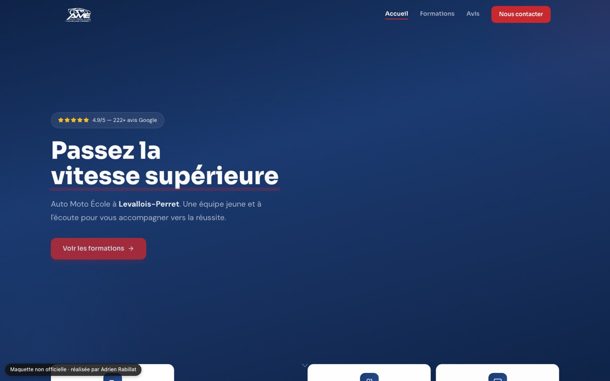

# Maquette — Auto-moto-école AME (Levallois-Perret)

Proposition de refonte du site d'une auto-moto-école. **Maquette non officielle**, réalisée de ma propre initiative : le site n'est pas indexé par les moteurs de recherche.

**Démo** : https://maquette-auto-ecole-ame.vercel.app



## Contenu

- Accueil avec mise en avant des avis Google, formations (permis B, moto, accompagnée), page avis et page contact
- Données des formations centralisées dans `src/data/services.js`
- Balises SEO par page avec `react-helmet-async`, animations avec `framer-motion`

## Stack

React 19, Vite 6, Tailwind CSS 4, React Router 7, Framer Motion, Lucide.

## Lancer en local

```bash
npm install
npm run dev
```

Déploiement : Vercel (`vercel.json` ajoute un en-tête `X-Robots-Tag: noindex`).
